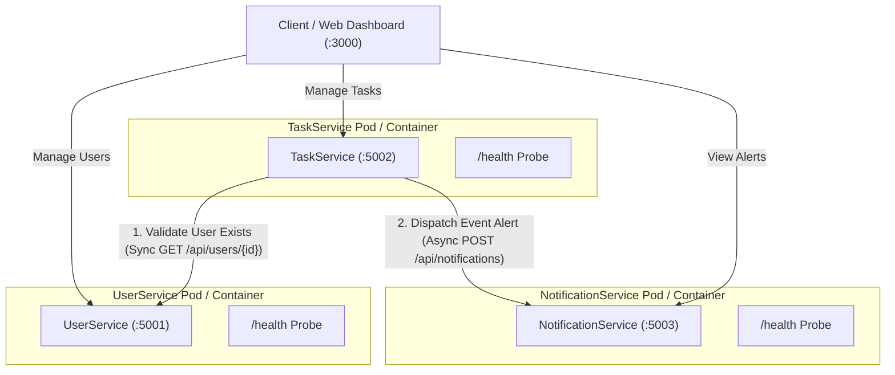

# 🚀 Microservices Task Manager

[](https://divyakumari1107.github.io/microservices-taskmanager/)
[](https://microservices-taskmanager.vercel.app/)


A production-style, distributed **Task Management System** built with **ASP.NET Core 8 Minimal APIs**, **Docker**, **Docker Compose**, and **Kubernetes**. Demonstrates microservices architecture patterns including inter-service REST communication, decoupling, health monitoring, and container orchestration.

---

## 🌐 Live Production Deployments

This project includes a live interactive cloud dashboard showcasing microservices service discovery, simulated CRUD task flows, inter-service alerts, and health metrics:

| Resource | Live Link | Status |
| :--- | :--- | :--- |
| **Microservices Cloud Dashboard (GitHub Pages)** | **[https://divyakumari1107.github.io/microservices-taskmanager/](https://divyakumari1107.github.io/microservices-taskmanager/)** | 🟢 **Live (24/7)** |
| **Microservices Live Mirror (Vercel)** | **[https://microservices-taskmanager.vercel.app/](https://microservices-taskmanager.vercel.app/)** | 🟢 **Production Ready** |

---

---

## 🏗️ Architecture Overview

The platform decomposes task management into three decoupled, independently scalable microservices plus an interactive Web Dashboard:



---

## 🧩 Microservices Breakdown

| Service | Port | Technology | Swagger UI Endpoint | Responsibilities |
| :--- | :--- | :--- | :--- | :--- |
| **UserService** | `5001` | ASP.NET Core 8 | `http://localhost:5001/swagger` | User directory, department mapping, UUID lookups |
| **TaskService** | `5002` | ASP.NET Core 8 | `http://localhost:5002/swagger` | Task lifecycle, synchronous validation with UserService, notification dispatch |
| **NotificationService** | `5003` | ASP.NET Core 8 | `http://localhost:5003/swagger` | Real-time event logging, recipient alert stream |
| **Web Dashboard** | `3000` | Nginx & HTML5/JS | `http://localhost:3000` | Live visual management, latency monitoring, 1-click test runner |

---

## 🔄 Inter-Service Communication Flow

1. **Synchronous Validation (Strict Dependency)**:
   * When a client calls `POST /api/tasks` with `{ title, assignedUserId }`, `TaskService` issues a synchronous HTTP GET call to `UserService` (`/api/users/{assignedUserId}`).
   * If the user does not exist, `TaskService` returns `HTTP 400 Bad Request` ("User does not exist in UserService").
   * If `UserService` is down, `TaskService` gracefully returns `HTTP 503 Service Unavailable`.

2. **Asynchronous Notification (Loose Coupling)**:
   * When a task is created or its status changes (`Pending` ➔ `InProgress` ➔ `Completed`), `TaskService` dispatches a `POST /api/notifications` payload to `NotificationService`.
   * If `NotificationService` is temporarily offline, task creation still succeeds without blocking (fire-and-forget resiliency pattern).

---

## ⚡ Quickstart: Running with Docker Compose

Ensure [Docker Desktop](https://www.docker.com/products/docker-desktop/) is running, then run:

### Windows (1-Click):
Double-click **`run.bat`** or execute in Command Prompt:

```cmd
docker compose up -d --build
```

### Access Endpoints:
* **Interactive Web Dashboard**: [http://localhost:3000](http://localhost:3000)
* **UserService Swagger UI**: [http://localhost:5001/swagger](http://localhost:5001/swagger)
* **TaskService Swagger UI**: [http://localhost:5002/swagger](http://localhost:5002/swagger)
* **NotificationService Swagger UI**: [http://localhost:5003/swagger](http://localhost:5003/swagger)

To stop all services:
```cmd
docker compose down
```

---

## 🧪 Automated Integration Testing

An automated Python test script tests the entire microservices lifecycle:

```cmd
python test_services.py
```

### What the test suite verifies:
1. `[TEST 1]` `/health` probes across all 3 services.
2. `[TEST 2]` User creation in `UserService`.
3. `[TEST 3]` Negative validation: verifies `TaskService` rejects a fake User ID with `HTTP 400`.
4. `[TEST 4]` Positive validation: creates task for valid user with `HTTP 201`.
5. `[TEST 5]` Checks `NotificationService` stream to ensure event arrived.
6. `[TEST 6]` Updates task status to `Completed`.

---

## ☸️ Kubernetes Deployment (`k8s/`)

Deploy the microservices stack onto any Kubernetes cluster (Minikube, Kind, EKS, GKE, AKS):

```bash
# 1. Apply all Kubernetes manifests
kubectl apply -f k8s/

# 2. Verify pods and services
kubectl get pods
kubectl get services

# 3. Access TaskService NodePort
minikube service task-service --url
```

Each Kubernetes manifest includes:
* **Deployments** with 2 replicas for high availability.
* **ClusterIP Services** for internal DNS resolution (`http://user-service:8080`, `http://notification-service:8080`).
* **Liveness & Readiness Probes** checking `/health`.
* **Resource Limits & Requests** for CPU and memory safety.

---

## 📁 Repository Directory Structure

```text
microservices-taskmanager/
├── docker-compose.yml          # Unified multi-container orchestration
├── README.md                   # Full documentation & architecture guides
├── run.bat                     # 1-click Windows startup script
├── test_services.py            # Automated end-to-end integration test suite
├── upload_to_github.bat        # Git push automation helper
├── k8s/                        # Kubernetes production manifests
│   ├── user-service.yaml
│   ├── task-service.yaml
│   └── notification-service.yaml
├── UserService/                # Port 5001: User directory microservice
│   ├── Dockerfile
│   ├── Program.cs
│   └── UserService.csproj
├── TaskService/                # Port 5002: Task management & orchestrator
│   ├── Dockerfile
│   ├── Program.cs
│   └── TaskService.csproj
├── NotificationService/        # Port 5003: Event logging & alerts
│   ├── Dockerfile
│   ├── Program.cs
│   └── NotificationService.csproj
└── web/                        # Port 3000: Modern browser dashboard
    └── index.html
```

---

## 🛡️ License

This project is licensed under the MIT License - open for educational and evaluation use.
